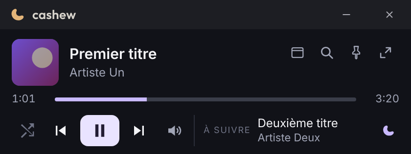
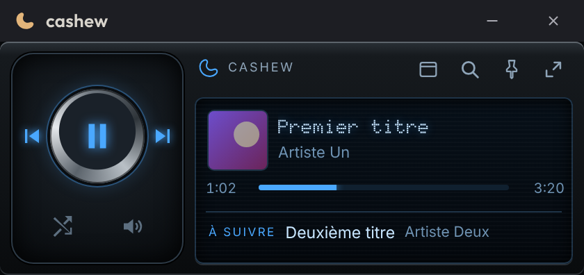
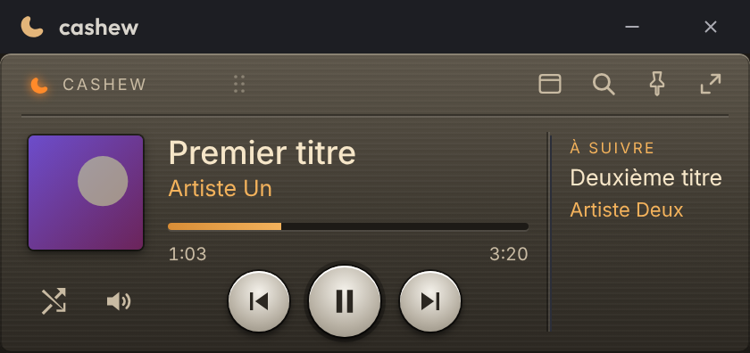
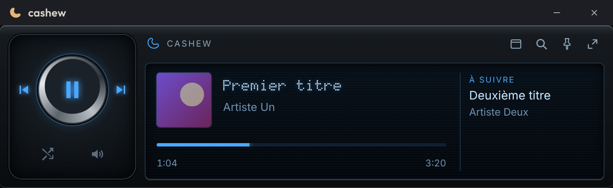
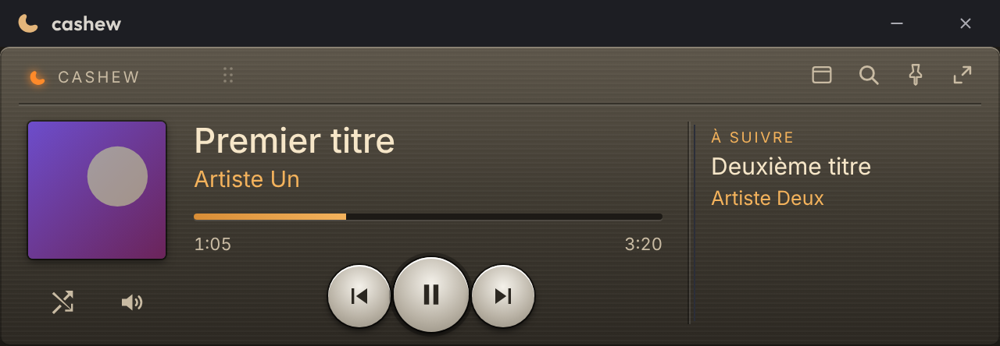

# cashew

A **YouTube Music** desktop player for **Windows**, with an always-at-hand mini-player.

cashew shows the official YouTube Music website in a dedicated window and adds what a browser tab lacks:
a compact mini-player with 5 skins, fast search across the user's playlists, an interactive queue, resume of
the last session and a global shortcut. The interface is in French.

| Actuel | Autoradio | Hi-fi |
|---|---|---|
|  |  |  |

## Features

- **Mini-player** in 5 skins: Actuel, Autoradio, Hi-fi, Autoradio 2000 (HF), Hi-Fi de salon (HF). Draggable
  progress bar, built-in volume, pin on top, optional title bar, move by the grip.
- **Search** across the tracks of the user's playlists (also offline), across the playlists themselves (with
  favorites) or the whole of YouTube Music; play now or play next.
- **Live queue**: click a track to play it, remove a track.
- **Resume** of the last track after a restart, at the same position.
- **Island** (optional): a pill at the top of the screen with the cover and synced lyrics; on hover, title, artist,
  progress (click to seek), three lyric lines, previous/play/pause/next, volume with the mouse wheel, cover color. Always shown, on each track
  change (compact or detailed), or only over games (per-game settings, new games offered), with a shortcut to show
  the details, adjustable size and opacity, subtle animations (can be turned off).
- **Synced lyrics in YouTube Music's Lyrics tab** (like Better Lyrics): the sung line lights up word by word and
  stays in view, click a line to go there; full screen with the cover and its colors, progress and controls, or the
  music video next to the lyrics; YouTube Music's own lyrics when no synced ones exist. A lyrics panel in the
  mini-player.
- **Global shortcut** (Ctrl+Alt+M by default), start with Windows, video fullscreen, built-in updates.

## Installation (Windows 10/11, 64-bit)

1. Open the [**latest release**](https://github.com/noitdecajou/cashew-music-player/releases/latest) and download
   `MusicPlayer-Setup-<version>.exe` from **Assets** (not "Source code").
2. Run the installer. The application is not code-signed, so Windows SmartScreen may show "Windows protected your
   PC": select **More info**, then **Run anyway**.
3. Sign in to YouTube Music in the large player.

**Updates:** cashew checks at startup and every 6 hours. When a version is available, a message announces it;
it is installed from **Réglages → Mises à jour** (Settings → Updates). Nothing is downloaded without the user's
consent.

**Antivirus:** some antivirus products wrongly flag Electron files (the engine of the application). If the window
stays blank or a message reports missing files, reinstall cashew, or restore the files from Windows Security →
Protection history.

## Privacy

- The Google sign-in stays in the application's local profile on the PC, as in a browser. cashew neither reads
  nor transmits credentials.
- cashew contains no tracking and no usage statistics.
- Network connections: **music.youtube.com** and the Google services YouTube Music needs (playback, sign-in),
  **github.com** to check for updates, and, while the island shows lyrics, the lyrics are open or YouTube Music's
  player page is shown, **lrclib.net** (the title, artist, album and duration of the track being played). Nothing else.
- Game detection reads, locally, which application is in front, its install folder and the list of games Windows
  knows; nothing is sent. Nothing is injected into games.
- Local data (in `%APPDATA%\Music Player`): preferences (including the game list), an index of the user's
  playlists for offline search, the last track played, a diagnostic log.

## Disclaimer

cashew is an independent project, **not affiliated with YouTube or Google**. YouTube and YouTube Music are
trademarks of Google LLC. cashew displays the official YouTube Music website; its use remains subject to the
YouTube Terms of Service. No YouTube Music Premium subscription is provided: the available features are those of
the user's account.

## Documentation

[Architecture](docs/architecture.md) · [YouTube Music bridge](docs/ytm-bridge.md) · [Roadmap](docs/roadmap.md) ·
[Releasing](docs/releasing.md) · [Code signing](docs/signing.md) · [Security](docs/security.md) ·
[Changelog](CHANGELOG.md)

## License

[MIT](LICENSE) © 2026 noitdecajou
